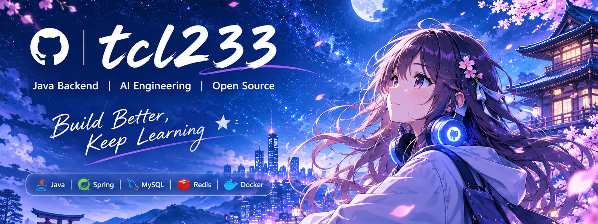

<!-- =========================================================
     tcl233 | Anime Aesthetic × Java Backend × AI Engineering
     Replace project placeholders and remove technologies you
     do not actively use or want to present.
========================================================== -->

## 💡 A Little Inspiration

> “If you want to create something great, you have to be willing to question everything.”
>
> — Paul Graham

> “Philosophy, Science, Mathematics, Humanities”
>
> -tcl

---

# Hello, I'm tcl233 👋

### Java Backend Developer · AI Explorer · Lifelong Learner

*Building things, exploring technology, and becoming better every day.*

## 🌌 About Me

- ☕ Focused on Java backend development and software engineering.
- 🔧 Exploring databases, caching, messaging, and distributed systems.
- 🤖 Learning about AI Agents, MCP, LLM applications, and agent workflows.
- 📚 Enjoy documenting what I learn and turning knowledge into practice.
- 🌱 Always learning, building, and improving.

## 🛠️ Tech Stack

**Languages**

**Backend & Data**

**Tools & Infrastructure**

## 🤖 AI & Engineering Interests

- **Agent systems:** agent architecture, tool calling, multi-agent orchestration.
- **Protocols & extensions:** MCP, skills, and hooks.
- **LLM applications:** RAG, LangGraph, Spring AI, and LangChain4j.
- **Engineering foundations:** API design, observability, reliability, and deployment.

## 📊 GitHub Statistics

## 🐍 Contribution Activity

<!-- Enable the GitHub Actions workflow for the snake before uncommenting this image. -->
<!--

  

-->

### ⚡ Always learning, always building, always evolving.

*Thanks for visiting my profile. Have a great day!*

